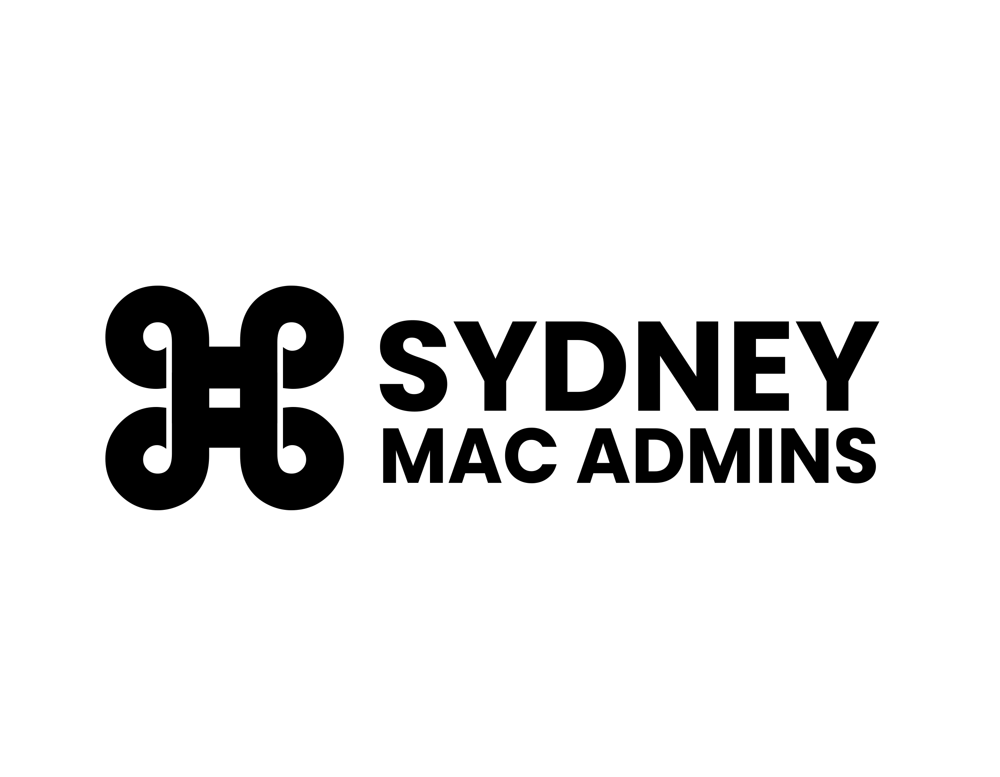

# Welcome to Sydney Mac Admins! 🍎

  

## About Us

Welcome to the official GitHub repository for Sydney Mac Admins! We're a community of macOS and Apple device administrators, enthusiasts, and professionals based in Sydney, Australia.

## 🌐 Visit Our Main Website

For the latest events, meetups, resources, and community updates, please visit our main website:

**[🔗 sydneymacadmins.com](https://sydneymacadmins.com)**

## What You'll Find Here

This repository hosts the source code for our GitHub Pages site, including:
- Event archives and information
- Community resources
- Meeting documentation
- Static assets and images

## Connect With Us

Join our vibrant community of Mac administrators and Apple enthusiasts!

### 🌐 Main Website
Visit [sydneymacadmins.com](https://sydneymacadmins.com) to:
- 📅 Find upcoming events and meetups
- 💬 Connect with fellow Mac admins
- 📚 Access resources and documentation
- 🎯 Stay updated with the latest in Apple enterprise management

### 💬 Slack Community
Join the conversation on the MacAdmins Slack workspace:
- **Workspace**: [macadmins.org](https://macadmins.org)
- **Channel**: `#sydney-macadmins`

Connect with Mac admins from around the world and chat with our local Sydney community in real-time!

---

  <strong>Sydney Mac Admins Community</strong> 
  <em>Bringing together Apple administrators across Sydney</em>

